# 🛰️ AstroVital

> **Autonomous Edge AI, Multi-Static Wi-Fi CSI Tomography & 3D Digital Twin for Deep-Space Crew Health — 100% Offline on Orange Pi 4 Pro (NASA Space Apps Challenge).**

🌐 **Language / Idioma:** [🇺🇸 English](README.md) · [🇧🇷 Português (Brasil)](README.pt-BR.md)

<p align="center">
  
</p>

<p align="center">
  
  
  
  
  
  
  
</p>

<table>
  <tr>
    <td align="center" width="33%"><a href="#7-judge-quickstart-guide">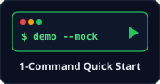<br><b>Quick Start</b></a></td>
    <td align="center" width="33%"><a href="#3-multi-static-rf-mesh-and-hardware">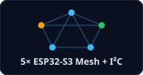<br><b>5× ESP32-S3 Mesh</b></a></td>
    <td align="center" width="33%"><a href="#4-available-ai-models-and-astronaut-learning"><br><b>AI Models &amp; Learning</b></a></td>
  </tr>
  <tr>
    <td align="center" width="33%"><a href="#anatomical-3d-digital-twin">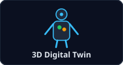<br><b>3D Digital Twin</b></a></td>
    <td align="center" width="33%"><a href="#how-the-interactive-game-helps-during-clinical-analysis"><br><b>Interactive Self-Exam Game</b></a></td>
    <td align="center" width="33%"><a href="#5-embedded-nasa-clinical-knowledge-base">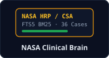<br><b>NASA Clinical Brain</b></a></td>
  </tr>
</table>

---

## 2. See Inside the Cabin with Wi-Fi and Edge AI

In lunar (Artemis) and Martian missions, **one-way communication delays up to 22 minutes** and **orbital blackout windows** make real-time Earth telemedicine impossible during acute events such as hypercapnia, SANS (*Spaceflight Associated Neuro-ocular Syndrome*), solar particle events, dehydration, and musculoskeletal deconditioning. **AstroVital** operates as an **autonomous onboard Flight Surgeon** with **zero cameras, zero mandatory wearables, and zero internet**.

| Capability | Earth-Dependent / Camera / Wearable Systems | **AstroVital (Wi-Fi CSI + Edge AI)** |
| :--- | :--- | :--- |
| **Deep-Space Blackout Resilience** | Fails during 22-min Mars latency or LOS blackouts | **100% autonomous & offline** on Orange Pi 4 Pro (`linux/arm64`) |
| **Crew Privacy & Compliance** | Optical cameras invade privacy; straps fail or get forgotten | **Passive RF CSI** (camera off) + optional I²C corroboration |
| **Baseline Personalization** | Generic Earth averages trigger constant false alarms | **Per-crew EMA baseline + clinical memory** (`crew_id`) |
| **Hardware Fault Tolerance** | Single sensor failure blinds the entire channel | **$N+1$ mesh failover** (`20 → 12 → 6` links in `< 500 ms`) |

<table>
  <tr>
    <td align="center" width="50%"><a href="#3-multi-static-rf-mesh-and-hardware">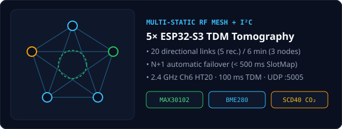</a><br><b>5× ESP32-S3 TDM Mesh + Auto-Discovery I²C</b></td>
    <td align="center" width="50%"><a href="#4-available-ai-models-and-astronaut-learning">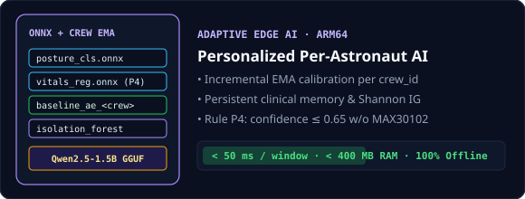</a><br><b>5 ONNX Models + Local SLM + Rule P4</b></td>
  </tr>
  <tr>
    <td align="center" width="50%"><a href="#anatomical-3d-digital-twin">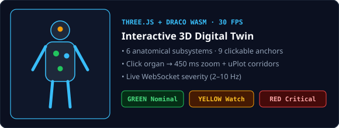</a><br><b>3D Anatomical Body + Live uPlot Corridors</b></td>
    <td align="center" width="50%"><a href="#how-the-interactive-game-helps-during-clinical-analysis">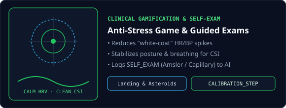</a><br><b>Anti-Stress Games + Guided Self-Exam</b></td>
  </tr>
</table>

---

## 3. Multi-Static RF Mesh and Hardware

```mermaid
flowchart LR
    subgraph FIELD["1. Field Cluster (5× ESP32-S3 | 2.4 GHz Ch 6 HT20)"]
        TDM["TDM Sweep 100 ms<br/>(5 × 20 ms = 20 Wi-Fi CSI links)"]
        I2C["I²C Auto-Discovery (SDA=GPIO8, SCL=GPIO9)<br/>MAX30102 (SpO2/HR) · BME280 (T/P/RH) · SCD40 (CO2)"]
    end

    subgraph CENTRAL["2. Central Orchestrator (Go 1.27 — ARM64)"]
        UDP["UDP Receiver / Sync :5005<br/>Hybrid JSON + Little-Endian Binary"]
        FSM["Cluster Manager<br/>Failover N+1 (20 → 12 → 6 links)"]
        PIPE["Zero-GC Ring Buffer<br/>[20][300] · Grace 30 ms"]
        SQLITE[("SQLite WAL + FTS5<br/>var/edgespace.db")]
        HTTPWS["HTTP REST + WebSocket :8000<br/>/api/* · /ws · Outbox Store-and-Forward"]
    end

    subgraph EDGEAI["3. Edge AI Worker (Python 3.11+ | TCP 127.0.0.1:5006)"]
        DSP["1-Antenna DSP Pipeline<br/>Unwrap · STO/CFO · Hampel · 64 Features"]
        ONNX["5 ONNX Models (< 50 ms, < 400 MB RAM)<br/>Posture · Cadence · Vitals · AE · IForest"]
        ADAPT["BaselineRegistry per crew_id<br/>Rule P4: confidence <= 0.65 w/o MAX30102"]
        CAUSAL["NASA HRP/CSA Causal Engine + Local SLM<br/>FTS5 BM25 · Shannon IG · Contraindications"]
    end

    subgraph UI["4. Tactical Panel & 3D Digital Twin (:5173 / :8000)"]
        TWIN["Anatomical 3D Body (Three.js)<br/>Severity GREEN / YELLOW / RED"]
        HUD["crew_id Selector · uPlot Corridors<br/>Self-Exam / Games · Clinical Chatbot"]
    end

    TDM -->|"CSI_FRAME 10 Hz"| UDP
    I2C -->|"Snapshots 1 Hz"| UDP
    UDP --> FSM --> PIPE
    PIPE --> SQLITE
    PIPE <-->|"IPC uint32 BE + JSON"| DSP
    DSP --> ONNX --> ADAPT --> CAUSAL
    CAUSAL -->|"TELEMETRY / ALERTS / CHAT"| HTTPWS
    HTTPWS <-->|"REST + WebSocket"| TWIN
    HTTPWS <-->|"REST + WebSocket"| HUD
```


<details>
<summary><strong>🔬 Sequence & Cluster Failover State Machine (Click to Expand)</strong></summary>

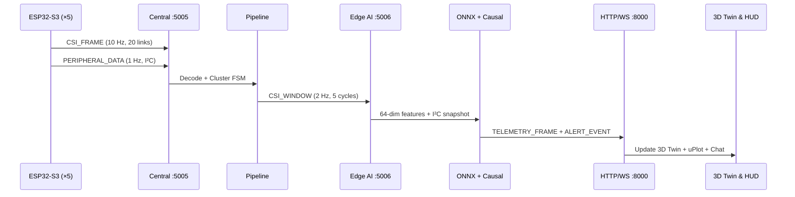

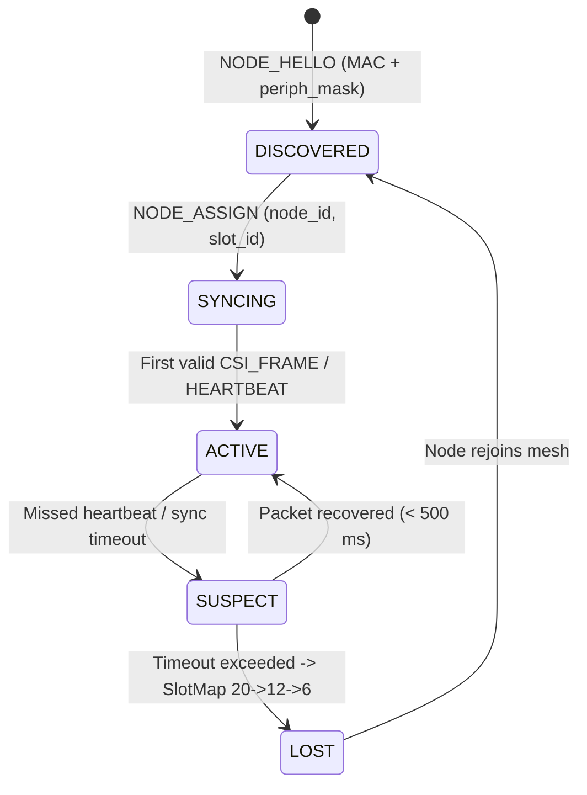

</details>

### Wi-Fi CSI Mesh Sizing: 5 ESPs Recommended vs. 3 Minimum

Each node pair forms two directional links ($N \times (N - 1)$). Adding nodes increases spatial diversity across the cabin volume, sharpening respiratory/postural separation and enabling $N+1$ redundancy:

| Mesh Configuration | Directional Links | Tomographic Coverage | Fault Tolerance ($N+1$) | Operational Status |
| :--- | :--- | :--- | :--- | :--- |
| **5× ESP32-S3 (Recommended)** | **20 links** | Full 3D cabin cross-section; best separation of breathing vs. posture motion. | **Survives up to 2 node losses** (`20 → 12 → 6`) | **Recommended** for judging & production fidelity. |
| **4× ESP32-S3 ($N-1$ Degraded)** | **12 links** | Strong cabin coverage; minor edge blind spots. | Survives 1 node loss (`12 → 6`) | Automatic TDM `SlotMap` failover (`< 500 ms`). |
| **3× ESP32-S3 (Minimum)** | **6 links** | Basic planar triangulation; coarse posture & respiration tracking. | **Zero redundancy** | **Hard operational minimum** for contactless sensing. |

> [!TIP]
> The Central Go `ClusterManager` handles this transition via FSM in **< 500 ms** on node drop. In simulated mode, `-Scenario node_loss` (`--scenario node_loss`) demonstrates live failover.

### I²C Auto-Discovery (`SDA=GPIO8`, `SCL=GPIO9`)

Every ESP32-S3 runs the **exact same homogeneous firmware** (`firmware/main/edgespace_proto.h`), probes the shared I²C bus at boot, and reports `detected_mask` (`PERIPH_BIT_MAX30102`, `PERIPH_BIT_BME280`, `PERIPH_BIT_SCD40`) inside `NODE_HELLO` and `HEARTBEAT`:

| Sensor | I²C Address | Telemetry Measured | Clinical Significance |
| :--- | :--- | :--- | :--- |
| **MAX30102** | `0x57` | SpO₂ (%), Heart Rate (BPM), Finger contact | Optical ground-truth corroboration (**Rule P4** unlocks AI confidence `> 0.65`). |
| **BME280** | `0x76` / `0x77` | Temperature (°C), Pressure (hPa), Humidity (%) | Cabin thermal comfort, dehydration risk, barometric stability. |
| **SCD40** | `0x62` | CO₂ (ppm), Temp, RH | Early **hypercapnia** detection in closed habitats. |

---


## 4. Available AI Models and Astronaut Learning

### AI Model Catalog (`edge-ai/models/`)

All base **ONNX** models load at boot with an Orange Pi 4 Pro ARM64 thread budget (`intra_op_num_threads=2`, `inter_op_num_threads=1`), executing in **< 50 ms per window** within **< 400 MB RAM** (DSP + ONNX sessions):

| Model File | Task | Input | Output | Clinical Rule / Role |
| :--- | :--- | :--- | :--- | :--- |
| `posture_cls.onnx` | Posture Classification | 64-dim CSI vector | `supine`, `sitting`, `standing`, `exercising`, `prone` + confidence | Provides posture context for vitals and `MODE_COUNTERMEASURE_EXERCISE`. |
| `exercise_cadence.onnx` | Exercise Cadence Regression | 64-dim CSI vector | Cadence (Hz / steps-per-min) + `is_exercising` | Tracks ARED countermeasure adherence and physical workload. |
| `vitals_reg.onnx` | Vital Signs Regression | 64-dim CSI vector | Respiration (Hz), HR (BPM), HRV (ms), `confidence` | **Clinical Rule P4:** caps `confidence <= 0.65` if no valid `MAX30102` reading in the last `10 s`. |
| `baseline_ae_default.onnx` | Autoencoder (Anomaly) | 64-dim normalized features | Reconstruction error (MSE) → anomaly score | Baseline deviation detection; fallback when crew-specific AE is absent. |
| `isolation_forest.onnx` | Isolation Forest | 64-dim raw CSI vector | Anomaly score `[0.0, 1.0]` | Complements Autoencoder (`0.55 * AE + 0.45 * IForest`). |
| `baseline_ae_<crew_id>.onnx` | **Personalized Autoencoder** | 64-dim normalized by `CrewBaseline` | Per-astronaut reconstruction MSE → anomaly score | Loaded dynamically per active `crew_id` for zero-cross-crew false positives. |

> [!IMPORTANT]
> **Local Conversational SLM (`LocalSLMSynthesizer`):** Runs quantized **`Qwen2.5-1.5B-Instruct` GGUF Q4_K_M** via `llama-cpp-python` (`n_ctx=1024`, `n_threads=2` on ARM64), 100% offline. It translates causal findings, live sensors, and clinical memory into empathetic responses **without ever altering the diagnostic escalation or countermeasures**. Passing `--no-slm` (`-NoSlm`) or running with `< 512 MB` free RAM switches seamlessly to a **deterministic template synthesizer**.

### How the Model Learns Each Astronaut's Patterns (`crew_id`)

AstroVital avoids false positives by comparing each astronaut **against their own baseline**, never a generic ground average:

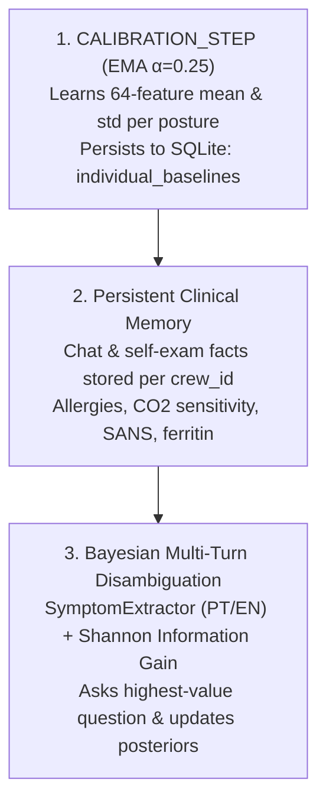

1. **Incremental EMA Calibration (`CalibrationEngine`):** During `CALIBRATION_STEP`, the engine updates the 64-feature mean, standard deviation, and anomaly threshold per posture (`supine`, `sitting`, `standing`, `exercise`, `prone`) via **Exponential Moving Average** ($\alpha = 0.25$) and persists them to SQLite (`individual_baselines`).
2. **Persistent Clinical Memory (`crew_clinical_memory`):** Facts shared in chat (allergies, active medications, SANS/motion-sickness history, CO₂ sensitivity, elevated ferritin) are stored per `crew_id` and filter all future clinical reasoning.
3. **Bayesian Multi-Turn Disambiguation (`Disambiguator`):** The bilingual (PT/EN) `SymptomExtractor` seeds candidate hypotheses while Shannon **Information Gain** picks the most discriminative follow-up question, enforcing hard contraindication locks (e.g., blocking iron if `ferritin > 500 µg/L`).

---

## 5. Embedded NASA Clinical Knowledge Base

AstroVital embeds its entire aerospace medical brain offline in `knowledge-base/`, indexed by **SQLite FTS5 (BM25)** and a **Causal Graph**:

| Collection / Layer | Scope & Contents | Offline Role |
| :--- | :--- | :--- |
| **NASA HRP & CSA Reports** (`knowledge-base/nasa_hrp_reports/`) | **5 Space Hazards** (Radiation, Isolation/Confinement, Distance from Earth, Altered Gravity, Hostile/Closed Environments), **11 Physiological Risks** (SANS/VIIP, bone/muscle loss, hypercapnia, fluid shift) & **8 Behavioral/Biochemical Risks** (circadian/HRV, cortisol/CRP, latent viruses). | Indexed into `clinical_reports_fts` (FTS5 BM25) and causal nodes linking symptoms + sensor signatures to countermeasures. |
| **Clinical Protocols & Nutrition SMO** (`knowledge-base/protocols/`) | Step-by-step self-exam procedures (Amsler Grid, capillary collection, ocular/renal ultrasound, ARED countermeasures) + **8 Nutrition SMO categories** with hard safety locks (e.g., **blocks iron supplementation if ferritin > 500 µg/L**). | Served offline to the frontend and enforced by `ClinicalRepository` before emitting any recommendation. |
| **36 Validated Golden Cases** (`knowledge-base/datasets/`) | End-to-end clinical audit fixtures pairing telemetry/symptoms with expected causal chains and `LOCAL` / `CREW` / `STORE_AND_FORWARD` escalation. | Verified automatically via `operational.py validate` (`36/36` pass). |
| **Space Health Research DB** (`database/space_health_sqlite/`) | Read-only reference corpus: 26 tables, 1.27M environmental rows, 6.3K radiation logs, 5 ESA/HREDA studies, 18 publications (161 physiological aggregates), preserving 781K missingness provenance events without imputation. | Separate read-only SQLite connection (`make db-research-validate`). |

---


## 6. Interactive 3D Digital Twin and Anti-Stress Game

### Anatomical 3D Digital Twin

*(Implemented in `frontend/src/features/twin3d/`)*

The React + Three.js panel (`ACESFilmicToneMapping`, `30 fps`, local **Draco WASM** and **Meshopt** decoders with zero network calls) renders a live 3D human body scaled to the active crew member's stature and skin tone (`skin.glb` + `eyes.glb` by default, with on-demand GLB layers for `heart`, `brain`, `lungs`, `kidneys`, `liver`, `gut`, `jugular`, `spine`, `vascular`, and `organs`). Clicking any of the **9 anatomical anchors** smoothly zooms the camera (`450 ms`) and opens live `uPlot` time-series charts (`OrganCharts`) for that subsystem:

<details>
<summary><strong>🧬 3D Twin Layer Pipeline & Severity Mapping (Click to Expand)</strong></summary>

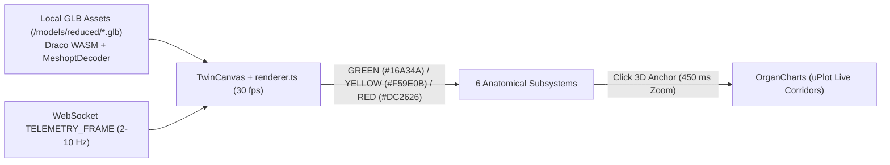

</details>

| Subsystem (`enum.subsystem`) | Clickable 3D Anchors | Live Series & Severity (`GREEN` / `YELLOW` / `RED`) |
| :--- | :--- | :--- |
| `CARDIOVASCULAR_FLUIDS` | `heart`, `jugular`, `vascular`, `kidneys` | Heart Rate (BPM), SpO₂ (%), HRV (ms) + severity |
| `RESPIRATORY_ATMOSPHERE` | `lungs` | SpO₂ (%), Respiratory Rate, CO₂ (ppm) + severity |
| `NEURO_OCULAR_SANS` | `brain` | HRV (ms) + SANS/VIIP severity |
| `MUSCULOSKELETAL_POSTURE` | `spine` | Classified posture + musculoskeletal severity |
| `IMMUNE_HEMATO_NUTRITION` | `liver`, `gut` | Immunometabolic & nutritional severity |
| `NEUROBEHAVIORAL_RADIATION` | `brain` (+ `ShelterOverlay` on alert) | HRV + radiation / neurobehavioral severity |

> [!NOTE]
> **Media / Screenshot Slot:** When capturing live browser screenshots or GIFs, save them under `assets/readme/` and embed them here alongside `card-twin3d.svg` and `card-selfexam-game.svg`.

### How the Interactive Game Helps During Clinical Analysis

The frontend pairs offline interactive mini-games (`frontend/src/features/games/`: **Landing Practice** at `/#/game/landing` and **Asteroids** at `/#/game/asteroids`, alongside `/#/leisure` and `/#/garden` gamification) with guided clinical **self-exam and calibration flows** (`SELF_EXAM` / `CALIBRATION_STEP` wired to `ChatDrawer` and NASA protocols):

1. **Reduces "White-Coat" Stress Spikes:** Interactive visuomotor challenges (low-gravity lunar pad touchdown in *Landing Practice* and asteroid navigation) divert cognitive focus before or between clinical checks, dampening sympathetic adrenaline surges that otherwise distort resting Heart Rate and Blood Pressure.
2. **Enforces Postural & Respiratory Stability for Wi-Fi CSI:** Guided calibration steps (`CALIBRATION_STEP`) pace breathing and hold steady postures, giving the 5× ESP32-S3 mesh clean RF CSI windows free of sudden motion artifacts.
3. **Improves Self-Exam Adherence & Precision (`SELF_EXAM`):** Multi-step aerospace medical exams such as the **Amsler Grid** (SANS/VIIP screening) and **capillary blood collection** become intuitive, low-friction flows with immediate feedback, logging structured results straight into the Edge AI causal engine.

---

## 7. Judge Quickstart Guide

### Track A — Full Mocked Demo (No ESP32 Hardware Required)

Launches the **entire real stack** (`Frontend Vite :5173` + `Central Go :8000` + `Edge AI Worker :5006` + `SQLite var/edgespace.db`), simulating only the 5× ESP32-S3 mesh in memory (`-mock-cluster=inproc`).

<details>
<summary><strong>🖥️ Windows (PowerShell) — Click to Expand</strong></summary>

```powershell
# Launch full stack and open http://localhost:5173/#/crew
powershell -ExecutionPolicy Bypass -File scripts/demo.ps1 -Mode mock

# Fast start without local SLM (deterministic template synthesizer) + active clinical scenario:
powershell -ExecutionPolicy Bypass -File scripts/demo.ps1 -Mode mock -Scenario hypercapnia -NoSlm

# Serve static UI embedded inside Central (:8000) without Vite dev server:
powershell -ExecutionPolicy Bypass -File scripts/demo.ps1 -Mode mock -StaticUi
```

> Backend-only alternative (no Vite): `powershell -ExecutionPolicy Bypass -File scripts/run_stack.ps1`

</details>

<details>
<summary><strong>🐧 Linux / Orange Pi 4 Pro (ARM64) / WSL — Click to Expand</strong></summary>

```bash
# Launch full stack (or use: make demo-mock)
./scripts/demo.sh --mock

# Headless / fast smoke test without SLM:
./scripts/demo.sh --mock --no-open --no-slm --smoke-seconds 5

# Start directly in a clinical scenario:
./scripts/demo.sh --mock --scenario hypercapnia --no-slm
```

</details>

#### 6 Simulatable Clinical Scenarios & 3-Minute Walkthrough

| Scenario | Clinical / Operational Trigger | Expected Panel Response |
| :--- | :--- | :--- |
| `nominal` | Baseline cabin physiology | All subsystems `GREEN`. |
| `hypercapnia` | Rising $\text{CO}_2$ (`SCD40`), RR/HR | `lungs` escalates `YELLOW → RED`; chat advises CO₂ scrubbing. |
| `sans` | Neuro-ocular markers (SANS/VIIP) | `brain` turns `YELLOW`; guided Amsler Grid self-exam flow. |
| `solar_storm` | Solar particle event (SPE) | Triggers `MODE_RADIATION_ALERT` and displays `ShelterOverlay`. |
| `dehydration_sleep` | Fluid loss + sleep debt | `heart`/`kidneys` turn `YELLOW`, HRV drops in longitudinal charts. |
| `node_loss` | Simulated ESP32-S3 node drop | `ClusterManager` executes $N+1$ failover (`20 → 12 → 6` links). |

Switch scenarios live while running: `curl -X POST http://127.0.0.1:8000/api/dev/scenario -d '{"scenario":"hypercapnia"}'` (or `Invoke-RestMethod` on PowerShell).

> [!TIP]
> **3-Minute Judge Walkthrough:**
> 1. **0:00–0:30** — Run `scripts/demo.ps1 -Mode mock` (or `./scripts/demo.sh --mock`) until the green banner confirms `Edge AI :5006`, `Central :8000`, and `Vite :5173`.
> 2. **0:30–1:30** — Open `http://localhost:5173/#/crew`, select a crew member to mount the **3D Digital Twin**, and click the **`heart`** or **`lungs`** anchor to inspect live `uPlot` charts.
> 3. **1:30–3:00** — Open the **Clinical Chat** (💬), type *"I feel dizzy and my vision is blurry"*, and switch to `hypercapnia` or `sans` to watch the causal engine + local SLM respond.

---

### Track B — Real Hardware Demo with ESP32-S3 Nodes (Firmware Flash + Live Mesh)

<details>
<summary><strong>🔌 Step-by-Step: Flash Firmware, Wire I²C &amp; Launch Live Mesh (Click to Expand)</strong></summary>

1. **Flash the single homogeneous firmware onto all ESP32-S3 boards (3 to 5 nodes):**
   - **Windows:** `powershell -ExecutionPolicy Bypass -File scripts/demo.ps1 -FlashOnly` (or `-Port COM5`)
   - **Linux:** `make flash-esp PORT=/dev/ttyUSB0` (or `cd firmware && idf.py set-target esp32s3 build && idf.py -p /dev/ttyUSB0 flash monitor`)
2. **Wire I²C sensors & power up the mesh (5 nodes recommended, 3 minimum):**
   - I²C bus: **`SDA = GPIO8`**, **`SCL = GPIO9`** (`MAX30102` `0x57`, `BME280` `0x76/0x77`, `SCD40` `0x62`).
   - Dedicated Wi-Fi: **`2.4 GHz`**, **Channel `6`**, **`HT20`**, `WIFI_PS_NONE`, connected to the Central AP (`10.42.0.1` / UDP `:5005`).
3. **Start Central listening to the physical mesh:**
   - **Windows:** `powershell -ExecutionPolicy Bypass -File scripts/demo.ps1 -Mode real` (add `-Flash` to flash and launch)
   - **Linux / Orange Pi 4 Pro:** `./scripts/demo.sh --real` or `make demo-real` (verify nodes transition to `ACTIVE` in cluster logs).

</details>

---

## 8. Prerequisites, Repository Structure, and Validation

### Dependencies (Exact Versions from Manifests)

| Component | Required Version | Manifest | Key Packages / Notes |
| :--- | :--- | :--- | :--- |
| **Go** | `1.27.4` | `central/go.mod` | `CGO_ENABLED=0`, `coder/websocket v1.8.15`, `modernc.org/sqlite v1.62.0` |
| **Python** | `>= 3.11` | `edge-ai/pyproject.toml` | `numpy>=1.26`, `scipy>=1.11`, `onnxruntime>=1.17`, `pydantic>=2.6`, `llama-cpp-python>=0.3` (optional) |
| **Node.js & pnpm** | `Node >= 26.11.1` + `pnpm` | `frontend/package.json` | `react 19.3.1`, `three 0.187.0`, `uplot 1.6.32`, `zustand 5.1.0`, `vite 8.3.8`, `typescript 6.0.3` |
| **ESP-IDF** *(optional)* | `v5.x` (`esp32s3`) | `firmware/CMakeLists.txt` | Required only in Mode B to compile/flash physical ESP32-S3 boards |

<details>
<summary><strong>🛠️ Manual Environment Setup & Repository Tree (Click to Expand)</strong></summary>

```bash
# Optional manual setup (demo.ps1 / demo.sh automate these steps automatically):
python3 -m venv edge-ai/.venv
source edge-ai/.venv/bin/activate     # Windows: .\edge-ai\.venv\Scripts\Activate.ps1
pip install -e "edge-ai[dev,slm]"
python edge-ai/training/build_all_models.py
PYTHONPATH=edge-ai/src python -m edgespace_ai.utils.model_fetch --models-dir edge-ai/models
python database/tools/operational.py migrate --db var/edgespace.db
cd frontend && pnpm install --frozen-lockfile && cd ..
```

```text
astrovital/
├── central/          # Go 1.27 Orchestrator (UDP :5005, IPC :5006, HTTP/WS :8000, SQLite WAL)
├── edge-ai/          # Python 3.11+ Worker (CSI DSP, 5 ONNX + crew_id, Causal Engine + SLM)
├── firmware/         # Homogeneous ESP-IDF v5.x Firmware (5× ESP32-S3 + I²C Auto-Discovery)
├── frontend/         # React 19 + Three.js (3D Digital Twin) + uPlot + Games + Vite 8
├── database/         # SQLite Migrations (0001..0006), Operational CLI, Space Health DB (RO)
├── knowledge-base/   # NASA HRP/CSA YAML Reports, Protocols, Nutrition SMO, 36 Golden Cases
├── contracts/        # Enums, JSON Schemas, and Cross-Layer Fixtures
├── scripts/          # One-Command Orchestrators (demo.ps1, demo.sh, run_stack.ps1)
├── deploy/           # ARM64 Orange Pi 4 Pro Configs (hostapd, dnsmasq, nftables, systemd)
└── Makefile          # Standardized Build, Test, DB, and Demo Targets
```

</details>

### Automated Validation Commands

```bash
# 1. Central Go unit tests
cd central && go test ./...

# 2. Edge AI Python unit & pipeline tests
cd edge-ai && pytest

# 3. End-to-End integration test (Edge AI :5006 + Central Go)
make test-e2e-ai

# 4. Operational DB validation (schema, FTS5, 36 clinical golden cases)
python database/tools/operational.py validate --db var/edgespace.db
make db-operational-test

# 5. Space Health research DB tests (read-only)
make db-research-test

# 6. Cross-layer contract validation (JSON Schema / fixtures)
make contracts-validate
# (equivalent to: python tools/validate_contracts.py)

# 7. Full-stack smoke test
./scripts/demo.sh --mock --no-open --no-slm --smoke-seconds 5
```

---

**AstroVital** — *Autonomous health intelligence for the final frontier.*  
Built for the **NASA Space Apps Challenge** so an autonomous Flight Surgeon travels alongside the crew.
