# 🛰️ AstroVital

> **Edge AI Autônoma, Tomografia Wi-Fi CSI Multi-Estática e Gêmeo Digital 3D para Saúde Espacial — 100% Offline na Orange Pi 4 Pro (NASA Space Apps Challenge).**

🌐 **Language / Idioma:** [🇺🇸 English](README.md) · [🇧🇷 Português (Brasil)](README.pt-BR.md)

<p align="center">
  
</p>

<p align="center">
  
  
  
  
  
  
  
</p>

<table>
  <tr>
    <td align="center" width="33%"><a href="#7-guia-prático-para-jurados">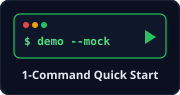<br><b>Guia Rápido (1 Comando)</b></a></td>
    <td align="center" width="33%"><a href="#3-malha-rf-multi-estática-e-hardware">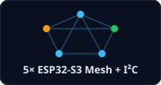<br><b>Malha 5× ESP32-S3</b></a></td>
    <td align="center" width="33%"><a href="#4-modelos-de-ia-disponíveis-e-aprendizado-do-astronauta">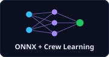<br><b>Modelos de IA &amp; Aprendizado</b></a></td>
  </tr>
  <tr>
    <td align="center" width="33%"><a href="#gêmeo-digital-anatômico-3d">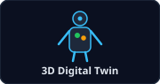<br><b>Gêmeo Digital 3D</b></a></td>
    <td align="center" width="33%"><a href="#como-o-jogo-interativo-ajuda-o-astronauta-na-análise"><br><b>Jogo &amp; Autoexame</b></a></td>
    <td align="center" width="33%"><a href="#5-bibliotecas-e-base-clínica-da-nasa-embarcadas">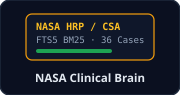<br><b>Base Clínica NASA</b></a></td>
  </tr>
</table>

---

## 2. Veja Dentro da Cabine com Wi-Fi e Edge AI

Em missões lunares (Artemis) e marcianas, **atrasos de comunicação de até 22 minutos** e **janelas de blackout orbital** inviabilizam a telemedicina em tempo real com a Terra diante de eventos agudos como hipercapnia, SANS (*Spaceflight Associated Neuro-ocular Syndrome*), tempestades solares, desidratação e perda de condicionamento físico. O **AstroVital** atua como um **Flight Surgeon autônomo a bordo** sem câmeras, sem vestíveis obrigatórios e sem internet.

| Capacidade | Sistemas Dependentes da Terra / Câmeras / Wearables | **AstroVital (Wi-Fi CSI + Edge AI)** |
| :--- | :--- | :--- |
| **Resiliência a Blackouts** | Falha com latência de 22 min de Marte ou perda de sinal | **100% autônomo e offline** na Orange Pi 4 Pro (`linux/arm64`) |
| **Privacidade & Adesão** | Câmeras invadem privacidade; cintas falham ou incomodam | **RF CSI passiva** (câmera desligada) + I²C opcional |
| **Personalização Fisiológica** | Médias genéricas de solo geram falsos alarmes | **Baseline EMA + memória clínica por `crew_id`** |
| **Tolerância a Falhas** | Perda de um sensor cega o monitoramento | **Failover $N+1$ na malha** (`20 → 12 → 6` enlaces em `< 500 ms`) |

<table>
  <tr>
    <td align="center" width="50%"><a href="#3-malha-rf-multi-estática-e-hardware">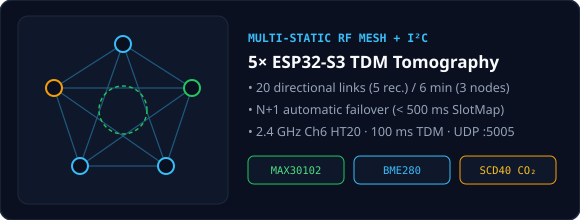</a><br><b>Malha TDM 5× ESP32-S3 + Auto-Discovery I²C</b></td>
    <td align="center" width="50%"><a href="#4-modelos-de-ia-disponíveis-e-aprendizado-do-astronauta">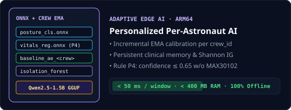</a><br><b>5 Modelos ONNX + SLM Local + Regra P4</b></td>
  </tr>
  <tr>
    <td align="center" width="50%"><a href="#gêmeo-digital-anatômico-3d">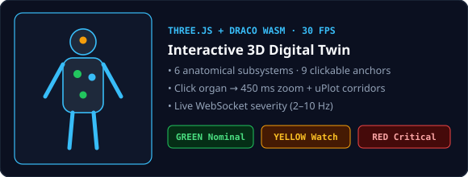</a><br><b>Corpo Anatômico 3D + Séries uPlot</b></td>
    <td align="center" width="50%"><a href="#como-o-jogo-interativo-ajuda-o-astronauta-na-análise">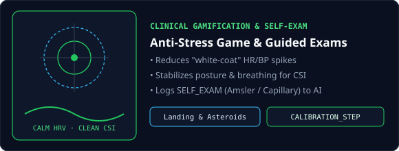</a><br><b>Jogos Antiestresse + Autoexame Guiado</b></td>
  </tr>
</table>

---

## 3. Malha RF Multi-Estática e Hardware

```mermaid
flowchart LR
    subgraph FIELD["1. Cluster de Campo (5× ESP32-S3 | 2.4 GHz Ch 6 HT20)"]
        TDM["Varredura TDM 100 ms<br/>(5 × 20 ms = 20 enlaces Wi-Fi CSI)"]
        I2C["Auto-Discovery I²C (SDA=GPIO8, SCL=GPIO9)<br/>MAX30102 (SpO2/FC) · BME280 (T/P/U) · SCD40 (CO2)"]
    end

    subgraph CENTRAL["2. Orquestrador Central (Go 1.27 — ARM64)"]
        UDP["UDP Receiver / Sync :5005<br/>Payload híbrido JSON + binário LE"]
        FSM["Cluster Manager<br/>Failover N+1 (20 → 12 → 6 enlaces)"]
        PIPE["Ring Buffer Zero-GC<br/>[20][300] · Grace 30 ms"]
        SQLITE[("SQLite WAL + FTS5<br/>var/edgespace.db")]
        HTTPWS["HTTP REST + WebSocket :8000<br/>/api/* · /ws · Outbox Store-and-Forward"]
    end

    subgraph EDGEAI["3. Worker Edge AI (Python 3.11+ | TCP 127.0.0.1:5006)"]
        DSP["Pipeline DSP 1-Antena<br/>Unwrap · STO/CFO · Hampel · 64 Features"]
        ONNX["5 Modelos ONNX (< 50 ms, < 400 MB RAM)<br/>Postura · Cadência · Vitais · AE · IForest"]
        ADAPT["BaselineRegistry por crew_id<br/>Regra P4: confidence <= 0.65 sem MAX30102"]
        CAUSAL["Motor Causal NASA HRP/CSA + SLM Local<br/>FTS5 BM25 · IG Shannon · Contraindicações"]
    end

    subgraph UI["4. Painel Tático & Gêmeo Digital 3D (:5173 / :8000)"]
        TWIN["Corpo Anatômico 3D (Three.js)<br/>Severidade GREEN / YELLOW / RED"]
        HUD["Seletor crew_id · Séries uPlot<br/>Autoexame / Jogos · Chatbot Clínico"]
    end

    TDM -->|"CSI_FRAME 10 Hz"| UDP
    I2C -->|"Snapshots 1 Hz"| UDP
    UDP --> FSM --> PIPE
    PIPE --> SQLITE
    PIPE <-->|"IPC uint32 BE + JSON"| DSP
    DSP --> ONNX --> ADAPT --> CAUSAL
    CAUSAL -->|"TELEMETRY / ALERTS / CHAT"| HTTPWS
    HTTPWS <-->|"REST + WebSocket"| TWIN
    HTTPWS <-->|"REST + WebSocket"| HUD
```

<details>
<summary><strong>🔬 Diagrama de Sequência & Máquina de Estados de Failover (Clique para expandir)</strong></summary>

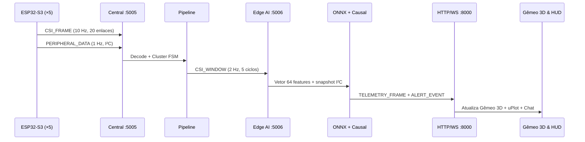

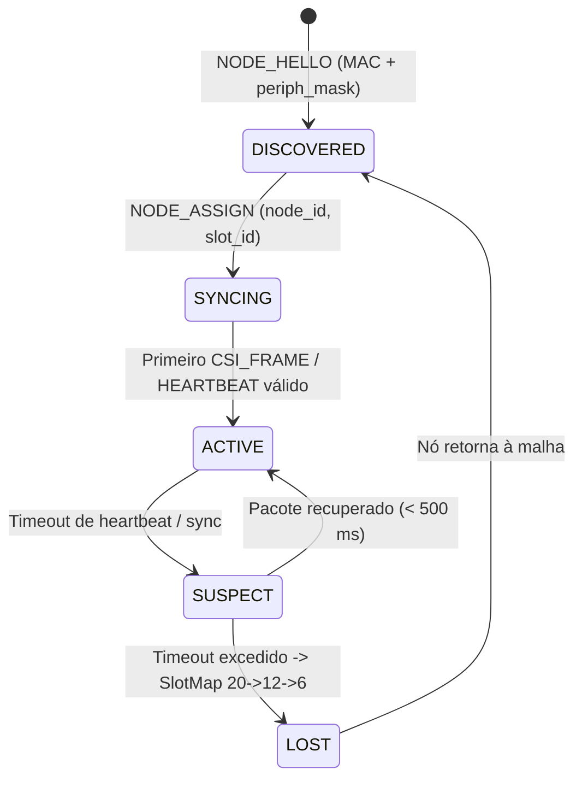

</details>

### Dimensionamento da Malha Wi-Fi CSI: 5 ESPs Recomendados vs. 3 Mínimo

Cada par de nós gera dois enlaces direcionais ($N \times (N - 1)$). Mais nós aumentam a diversidade espacial através do volume da cabine, refinando a separação respiratória/postural e garantindo redundância $N+1$:

| Configuração | Enlaces Direcionais | Cobertura Tomográfica | Tolerância a Falhas ($N+1$) | Status Operacional |
| :--- | :--- | :--- | :--- | :--- |
| **5× ESP32-S3 (Recomendado)** | **20 enlaces** | Tomografia volumétrica completa da cabine; melhor separação respiração vs. postura. | **Suporta perda de até 2 nós** (`20 → 12 → 6`) | **Recomendado** para avaliação e operação real. |
| **4× ESP32-S3 (Degradação $N-1$)** | **12 enlaces** | Boa cobertura; pequenas sombras nos cantos da cabine. | Suporta perda de 1 nó (`12 → 6`) | Failover TDM automático via `SlotMap` (`< 500 ms`). |
| **3× ESP32-S3 (Mínimo)** | **6 enlaces** | Triangulação planar básica; detecção bruta de respiração e movimento. | **Zero redundância** | **Mínimo absoluto** para monitoramento sem contato. |

> [!TIP]
> O `ClusterManager` da Central Go executa essa transição via FSM em **< 500 ms** quando há queda de nó. No modo simulado, `-Scenario node_loss` (`--scenario node_loss`) demonstra o failover ao vivo.

### Auto-Discovery I²C (`SDA=GPIO8`, `SCL=GPIO9`)

Cada ESP32-S3 executa o **mesmo firmware homogêneo** (`firmware/main/edgespace_proto.h`), sonda o barramento I²C no boot e reporta a bitmask `detected_mask` (`PERIPH_BIT_MAX30102`, `PERIPH_BIT_BME280`, `PERIPH_BIT_SCD40`) dentro de `NODE_HELLO` e `HEARTBEAT`:

| Sensor | Endereço I²C | Variáveis Medidas | Papel Clínico |
| :--- | :--- | :--- | :--- |
| **MAX30102** | `0x57` | SpO₂ (%), Frequência Cardíaca (BPM), Detecção de dedo | Corroboração óptica (**Regra P4** libera confiança da IA `> 0.65`). |
| **BME280** | `0x76` / `0x77` | Temperatura (°C), Pressão (hPa), Umidade (%) | Conforto térmico, risco de desidratação e estabilidade barométrica. |
| **SCD40** | `0x62` | CO₂ (ppm), Temperatura, Umidade | Detecção precoce de **hipercapnia** em habitats fechados. |

---

## 4. Modelos de IA Disponíveis e Aprendizado do Astronauta

### Catálogo de Modelos de IA (`edge-ai/models/`)

Os 5 modelos **ONNX** base são carregados no boot com orçamento controlado para ARM64 (`intra_op_num_threads=2`, `inter_op_num_threads=1`, **< 50 ms por janela** e **< 400 MB de RAM** para DSP + ONNX):

| Modelo | Tarefa | Entrada | Saída | Regra / Papel Clínico |
| :--- | :--- | :--- | :--- | :--- |
| `posture_cls.onnx` | Classificação de Postura | Vetor CSI 64-dim | `supine`, `sitting`, `standing`, `exercising`, `prone` | Fornece contexto postural para vitais e modo `MODE_COUNTERMEASURE_EXERCISE`. |
| `exercise_cadence.onnx` | Regressão de Cadência | Vetor CSI 64-dim | Cadência (Hz / passos por min) + `is_exercising` | Acompanhamento de contramedidas (ARED) e carga física. |
| `vitals_reg.onnx` | Regressão de Sinais Vitais | Vetor CSI 64-dim | Respiração (Hz), FC (BPM), HRV (ms), `confidence` | **Regra Clínica P4:** limita `confidence <= 0.65` sem `MAX30102` válido nos últimos `10 s`. |
| `baseline_ae_default.onnx` | Autoencoder (Anomalia) | 64 features normalizadas | Erro de reconstrução (MSE) → score de anomalia | Detecta desvios fisiológicos; usado como fallback quando não há modelo próprio do tripulante. |
| `isolation_forest.onnx` | Isolation Forest | Vetor CSI 64-dim bruto | Score de anomalia `[0.0, 1.0]` | Complementa o Autoencoder (`0.55 * AE + 0.45 * IForest`). |
| `baseline_ae_<crew_id>.onnx` | **Autoencoder Personalizado** | 64 features normalizadas por `CrewBaseline` | Erro de reconstrução individual por `crew_id` | Carregado dinamicamente quando presente para o astronauta ativo. |

> [!IMPORTANT]
> **SLM Conversacional Local (`LocalSLMSynthesizer`):** executa o modelo quantizado **`Qwen2.5-1.5B-Instruct` GGUF Q4_K_M** via `llama-cpp-python` (`n_ctx=1024`, `n_threads=2` em ARM64), 100% offline. Ele traduz achados causais, leituras de sensores e fatos da memória clínica em respostas naturais e empáticas **sem nunca alterar o diagnóstico ou escalonamento**. Caso `--no-slm` (`-NoSlm`) seja usado ou a RAM livre esteja abaixo de `512 MB`, o sistema alterna instantaneamente para um **sintetizador determinístico por templates**.

### Como o Modelo Aprende os Padrões de Cada Astronauta (`crew_id`)

O AstroVital evita falsos positivos comparando cada astronauta **consigo mesmo** (e não com uma média genérica de solo):

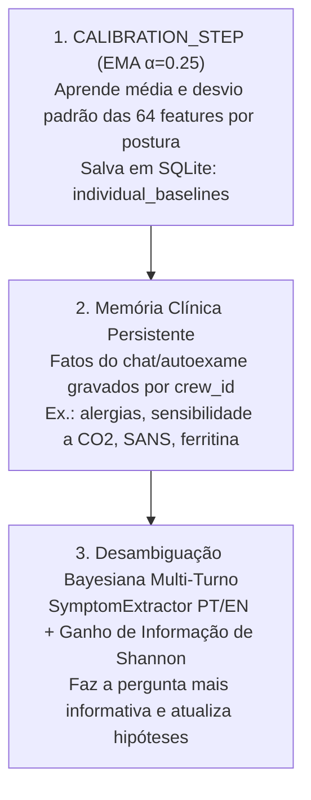

1. **Calibração Incremental (EMA — `CalibrationEngine`):** Durante o `CALIBRATION_STEP`, o motor atualiza via *Exponential Moving Average* ($\alpha = 0.25$) a média, o desvio padrão e o limiar de anomalia das 64 features de CSI + sinais vitais por postura (`supine`, `sitting`, `standing`, `exercise`, `prone`), persistindo em `individual_baselines` no SQLite.
2. **Memória Clínica Persistente (`crew_clinical_memory`):** Fatos relatados no chat (alergias, medicações em uso, histórico de SANS/cinetose, sensibilidade a $\text{CO}_2$, ferritina elevada) ficam vinculados ao `crew_id` e filtram recomendações futuras.
3. **Desambiguação Bayesiana Multi-Turno (`Disambiguator`):** O extrator bilíngue (PT/EN) levanta hipóteses causais e calcula o **Ganho de Informação (Entropia de Shannon)** para escolher a pergunta clínica mais discriminativa, aplicando travas de contraindicação (ex.: bloqueio de ferro quando `ferritina > 500 µg/L`).

---

## 5. Bibliotecas e Base Clínica da NASA Embarcadas

Todo o acervo médico aeroespacial é pré-carregado **offline** em `knowledge-base/`, indexado via **SQLite FTS5 (BM25)** e conectado a um **Grafo Causal**:

| Coleção / Camada | Escopo & Conteúdo | Papel Offline |
| :--- | :--- | :--- |
| **Relatórios NASA HRP & CSA** (`knowledge-base/nasa_hrp_reports/`) | **5 Perigos do Voo Espacial** (Radiação, Isolamento/Confinamento, Distância da Terra, Gravidade Alterada, Ambientes Hostis/Fechados), **11 Riscos Fisiológicos** (SANS/VIIP, perda óssea/muscular, hipercapnia, redistribuição de fluidos) e **8 Riscos Comportamentais/Bioquímicos** (sono/HRV, cortisol/CRP, vírus latentes). | Indexados em `clinical_reports_fts` (FTS5 BM25) e em nós causais ligando sintomas + assinaturas de sensores a contramedidas. |
| **Protocolos Clínicos & Nutrition SMO** (`knowledge-base/protocols/`) | Guias passo a passo de autoexame (Grade de Amsler, coleta capilar, ultrassom ocular/renal, protocolo ARED) + **8 categorias do *Nutrition SMO*** com travas rígidas (ex.: **bloqueio automático de ferro quando ferritina > 500 µg/L**). | Servidos localmente para o painel e verificados pelo `ClinicalRepository` antes de emitir recomendações. |
| **36 Golden Cases Clínicos** (`knowledge-base/datasets/`) | Vetores de auditoria ponta a ponta que cruzam telemetria/sintomas com cadeias causais e escalonamento (`LOCAL` / `CREW` / `STORE_AND_FORWARD`). | Validados automaticamente via `operational.py validate` (`36/36`). |
| **Banco de Pesquisa Space Health** (`database/space_health_sqlite/`) | Corpus de referência somente leitura: 26 tabelas, 1,27M linhas ambientais, 6,3 mil medições de radiação, 5 estudos ESA/HREDA, 18 publicações (161 agregados fisiológicos) e 781 mil eventos de ausência preservados sem imputação. | Conexão SQLite separada somente leitura (`make db-research-validate`). |

---

## 6. Experiência Interativa com Gêmeo Digital 3D e Jogo Antiestresse

### Gêmeo Digital Anatômico 3D

*(Implementado em `frontend/src/features/twin3d/`)*

O painel React + Three.js (`ACESFilmicToneMapping`, `30 fps`, decoders locais **Draco WASM** e **Meshopt** sem rede) renderiza um corpo humano 3D escalado pela estatura do tripulante e tom de pele (`skin.glb` + `eyes.glb` por padrão, com camadas sob demanda para `heart`, `brain`, `lungs`, `kidneys`, `liver`, `gut`, `jugular`, `spine`, `vascular` e `organs`). Ao clicar em um dos **9 marcadores anatômicos**, a câmera faz zoom suave (`450 ms`) e abre os gráficos em tempo real do subsistema correspondente (`OrganCharts` com `uPlot`):

| Subsistema (`enum.subsystem`) | Marcadores Clicáveis | Séries & Severidade (`GREEN` / `YELLOW` / `RED`) |
| :--- | :--- | :--- |
| `CARDIOVASCULAR_FLUIDS` | `heart`, `jugular`, `vascular`, `kidneys` | FC (BPM), SpO₂ (%), HRV (ms) + severidade |
| `RESPIRATORY_ATMOSPHERE` | `lungs` | SpO₂ (%), Frequência Respiratória, CO₂ (ppm) + severidade |
| `NEURO_OCULAR_SANS` | `brain` | HRV (ms) + severidade SANS/VIIP |
| `MUSCULOSKELETAL_POSTURE` | `spine` | Classe de postura + severidade |
| `IMMUNE_HEMATO_NUTRITION` | `liver`, `gut` | Severidade imunometabólica/nutricional |
| `NEUROBEHAVIORAL_RADIATION` | `brain` (+ `ShelterOverlay` em alerta) | HRV + severidade de radiação / neurocomportamental |

> [!NOTE]
> **Espaço para Mídia / Capturas de Tela:** Ao capturar screenshots ou GIFs reais do navegador em execução, salve em `assets/readme/` e incorpore aqui ao lado de `card-twin3d.svg` e `card-selfexam-game.svg`.

### Como o Jogo Interativo Ajuda o Astronauta na Análise

O frontend combina módulos lúdicos offline (`frontend/src/features/games/`: **Landing Practice** em `/#/game/landing` e **Asteroids** em `/#/game/asteroids`, além da área de lazer `/#/leisure` e gamificação `/#/garden`) com fluxos guiados de **autoexame e calibração** (`SELF_EXAM` / `CALIBRATION_STEP` integrados ao `ChatDrawer` e aos protocolos clínicos):

1. **Redução de Ansiedade ("Efeito Avental Branco"):** Desafios interativos de controle visuomotor (como pouso lunar em baixa gravidade no *Landing Practice* e desvio de asteroides) desviam o foco cognitivo antes ou entre sessões clínicas, atenuando picos adrenérgicos artificiais de FC e pressão arterial.
2. **Estabilização Postural e Respiratória para Wi-Fi CSI:** Durante etapas guiadas de respiração/calibração (`CALIBRATION_STEP`), o tripulante mantém postura estável e cadência controlada — garantindo janelas limpas de radiofrequência CSI nos 5 ESP32-S3 sem artefatos de movimento brusco.
3. **Adesão e Precisão nos Autoexames (`SELF_EXAM`):** Procedimentos complexos como a **Grade de Amsler** (triagem neuro-ocular de SANS) e **coleta capilar** são conduzidos passo a passo com feedback imediato, enviando resultados estruturados direto para o motor causal da Edge AI.

---

## 7. Guia Prático para Jurados

### Trilha A — Teste Completo com Dados Mockados (Sem Hardware ESP32)

Sobe **toda a stack real** (`Frontend Vite :5173` + `Central Go :8000` + `Worker Edge AI :5006` + `SQLite var/edgespace.db`), simulando apenas os 5 ESP32-S3 em memória (`-mock-cluster=inproc`).

<details>
<summary><strong>🖥️ Windows (PowerShell) — Clique para expandir</strong></summary>

```powershell
# Sobe a stack completa e abre http://localhost:5173/#/crew
powershell -ExecutionPolicy Bypass -File scripts/demo.ps1 -Mode mock

# Execução rápida sem SLM (sintetizador determinístico) e já com cenário clínico ativo:
powershell -ExecutionPolicy Bypass -File scripts/demo.ps1 -Mode mock -Scenario hypercapnia -NoSlm

# Servir UI estática embutida na Central (:8000) sem servidor Vite:
powershell -ExecutionPolicy Bypass -File scripts/demo.ps1 -Mode mock -StaticUi
```

> Alternativa backend-only (sem Vite): `powershell -ExecutionPolicy Bypass -File scripts/run_stack.ps1`

</details>

<details>
<summary><strong>🐧 Linux / Orange Pi 4 Pro (ARM64) / WSL — Clique para expandir</strong></summary>

```bash
# Sobe a stack completa (ou use: make demo-mock)
./scripts/demo.sh --mock

# Modo headless / smoke test rápido sem SLM:
./scripts/demo.sh --mock --no-open --no-slm --smoke-seconds 5

# Iniciar direto em um cenário clínico:
./scripts/demo.sh --mock --scenario hypercapnia --no-slm
```

</details>

#### 6 Cenários Clínicos Simuláveis & Roteiro de 3 Minutos

| Cenário | Gatilho Clínico / Operacional | Comportamento Esperado no Painel |
| :--- | :--- | :--- |
| `nominal` | Fisiologia e cabine nominais | Todos subsistemas em `GREEN`. |
| `hypercapnia` | Elevação de $\text{CO}_2$ (`SCD40`), RR/FC | `lungs` evolui `YELLOW → RED`; chat orienta depuração de $\text{CO}_2$. |
| `sans` | Marcadores neuro-oculares (SANS/VIIP) | `brain` em `YELLOW`; fluxo guiado com Grade de Amsler. |
| `solar_storm` | Pico de radiação solar (SPE) | Ativa `MODE_RADIATION_ALERT` e exibe `ShelterOverlay`. |
| `dehydration_sleep` | Desidratação + privação de sono | `heart`/`kidneys` em `YELLOW`, queda de HRV nas séries longitudinais. |
| `node_loss` | Queda física simulada de nó ESP32-S3 | `ClusterManager` executa failover $N+1$ (`20 → 12 → 6` enlaces). |

Troca em tempo real com a stack ativa: `curl -X POST http://127.0.0.1:8000/api/dev/scenario -d '{"scenario":"hypercapnia"}'` (ou `Invoke-RestMethod` no PowerShell).

> [!TIP]
> **Roteiro de 3 Minutos para Jurados:**
> 1. **0:00–0:30** — Rode `scripts/demo.ps1 -Mode mock` (ou `./scripts/demo.sh --mock`) e aguarde o banner verde confirmar `Edge AI :5006`, `Central :8000` e `Vite :5173`.
> 2. **0:30–1:30** — Em `http://localhost:5173/#/crew`, selecione um astronauta para abrir o **Gêmeo Digital 3D** e clique no marcador **`heart`** ou **`lungs`** para ver os gráficos `uPlot` em tempo real.
> 3. **1:30–3:00** — Abra o **Chat Clínico** (💬), relate *"estou tonto e com visão turva"* e alterne o cenário para `hypercapnia` ou `sans` para observar o motor causal + SLM local em ação.

---

### Trilha B — Teste Real com Placas ESP32-S3 (Gravação de Firmware + Live Mesh)

<details>
<summary><strong>🔌 Passo a Passo: Gravar Firmware, Ligar I²C &amp; Subir Malha Física (Clique para expandir)</strong></summary>

1. **Gravar o firmware único homogêneo nos ESP32-S3 (3 a 5 placas):**
   - **Windows:** `powershell -ExecutionPolicy Bypass -File scripts/demo.ps1 -FlashOnly` (ou `-Port COM5`)
   - **Linux:** `make flash-esp PORT=/dev/ttyUSB0` (ou `cd firmware && idf.py set-target esp32s3 build && idf.py -p /dev/ttyUSB0 flash monitor`)
2. **Conectar I²C e ligar a malha (5 nós recomendados, 3 mínimo):**
   - Barramento I²C: **`SDA = GPIO8`**, **`SCL = GPIO9`** (`MAX30102` `0x57`, `BME280` `0x76/0x77`, `SCD40` `0x62`).
   - Rede Wi-Fi dedicada: **`2.4 GHz`**, **Canal `6`**, **`HT20`**, `WIFI_PS_NONE`, conectando ao AP da Central (`10.42.0.1` / UDP `:5005`).
3. **Subir a Central escutando a malha física:**
   - **Windows:** `powershell -ExecutionPolicy Bypass -File scripts/demo.ps1 -Mode real` (ou adicione `-Flash`)
   - **Linux / Orange Pi 4 Pro:** `./scripts/demo.sh --real` ou `make demo-real` (acompanhe os nós passando para `ACTIVE` no log do cluster).

</details>

---

## 8. Pré-requisitos, Estrutura do Repositório e Validação

### Dependências (Versões dos Manifestos)

| Componente | Versão Requerida | Manifesto | Principais Pacotes / Observações |
| :--- | :--- | :--- | :--- |
| **Go** | `1.27.4` | `central/go.mod` | `CGO_ENABLED=0`, `coder/websocket v1.8.15`, `modernc.org/sqlite v1.62.0` |
| **Python** | `>= 3.11` | `edge-ai/pyproject.toml` | `numpy>=1.26`, `scipy>=1.11`, `onnxruntime>=1.17`, `pydantic>=2.6`, `llama-cpp-python>=0.3` (opcional) |
| **Node.js & pnpm** | `Node >= 26.11.1` + `pnpm` | `frontend/package.json` | `react 19.3.1`, `three 0.187.0`, `uplot 1.6.32`, `zustand 5.1.0`, `vite 8.3.8`, `typescript 6.0.3` |
| **ESP-IDF** *(opcional)* | `v5.x` (`esp32s3`) | `firmware/CMakeLists.txt` | Necessário apenas no Modo B para compilar/gravar os ESP32-S3 físicos |

<details>
<summary><strong>🛠️ Setup Manual do Ambiente & Estrutura do Monorepo (Clique para expandir)</strong></summary>

```bash
# Setup manual opcional (os scripts demo.ps1 / demo.sh já automatizam estes passos):
python3 -m venv edge-ai/.venv
source edge-ai/.venv/bin/activate     # Windows: .\edge-ai\.venv\Scripts\Activate.ps1
pip install -e "edge-ai[dev,slm]"
python edge-ai/training/build_all_models.py
PYTHONPATH=edge-ai/src python -m edgespace_ai.utils.model_fetch --models-dir edge-ai/models
python database/tools/operational.py migrate --db var/edgespace.db
cd frontend && pnpm install --frozen-lockfile && cd ..
```

```text
astrovital/
├── central/          # Orquestrador Go 1.27 (UDP :5005, IPC :5006, HTTP/WS :8000, SQLite WAL)
├── edge-ai/          # Worker Python 3.11+ (DSP CSI, 5 ONNX + crew_id, Motor Causal + SLM)
├── firmware/         # Firmware homogêneo ESP-IDF v5.x (5× ESP32-S3 + Auto-Discovery I²C)
├── frontend/         # Painel React 19 + Three.js (Gêmeo Digital 3D) + uPlot + Jogos + Vite 8
├── database/         # Migrations (0001..0006), CLI operacional, Base Space Health (RO)
├── knowledge-base/   # Relatórios NASA HRP/CSA YAML, Protocolos, Nutrition SMO, 36 Golden Cases
├── contracts/        # Enums, JSON Schemas e Fixtures de contrato entre camadas
├── scripts/          # Orquestradores One-Command (demo.ps1, demo.sh, run_stack.ps1)
├── deploy/           # Configs ARM64 Orange Pi 4 Pro (hostapd, dnsmasq, nftables, systemd)
└── Makefile          # Alvos padronizados de build, teste, banco e demonstração
```

</details>

### Comandos Rápidos de Validação Automatizada

```bash
# 1. Testes unitários do Orquestrador Central (Go)
cd central && go test ./...

# 2. Testes unitários e de pipeline do Worker Edge AI (Python)
cd edge-ai && pytest

# 3. Teste de integração E2E real (Edge AI :5006 + Central Go)
make test-e2e-ai

# 4. Validação do banco operacional, FTS5 e 36 golden cases clínicos
python database/tools/operational.py validate --db var/edgespace.db
make db-operational-test

# 5. Testes da base de pesquisa Space Health (somente leitura)
make db-research-test

# 6. Validação de contratos JSON Schema / fixtures
make contracts-validate
# (equivalente a: python tools/validate_contracts.py)

# 7. Smoke test ponta a ponta da stack completa
./scripts/demo.sh --mock --no-open --no-slm --smoke-seconds 5
```

---

**AstroVital** — *Inteligência de saúde autônoma para a fronteira final.*  
Desenvolvido para o **NASA Space Apps Challenge** para levar um Flight Surgeon autônomo junto com a tripulação.