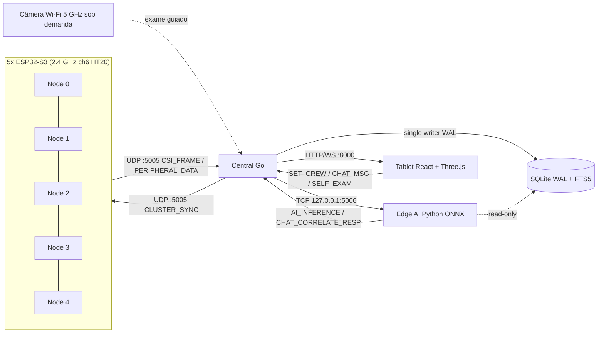

# EdgeSpace — Plano Mestre de Arquitetura (00)

> Projeto: **EdgeSpace** (NASA Space Apps Challenge — *Health Monitoring Software for Astronauts on Space Missions*)
> Estado: Consolidação arquitetural e estruturação do monorepo.
> Equipe: **Selliny** (M1 — Base Clínica & DB), **Nicolas** (M2 — Firmware ESP32-S3), **Rafael** (M3 — Frontend & Chatbot), **Leonardo** (M4 — Central Go / Integrador), **Santiago / Leonardo** (M5 — Edge AI).

---

## 1. Missão e Restrições Inegociáveis

1. **100% Local (Offline-First / Zero Cloud):** Missões Artemis/Marte enfrentam latência de até 22 min e blecautes de link. Proibido qualquer serviço de nuvem, CDN, DNS público, telemetria externa ou download em runtime. Fontes, assets 3D (`.glb`), decoders Draco, modelos `.onnx`, wheels Python e base clínica ficam embarcados na estação.
2. **Alvo de Hardware Fixo:**
   - **Estação Central:** **Orange Pi 4 Pro** (`linux/arm64`), executando AP Wi-Fi local (`hostapd`), Orquestrador Central em Go (`CGO_ENABLED=0`), worker Python (`onnxruntime`) e banco SQLite (`WAL + FTS5`).
   - **Cluster RF/Sensores:** **5× ESP32-S3** homogêneos (mesmo binário compilado com `ESP-IDF v5.x`), em **2.4 GHz ch 6 HT20**, formando malha TDM de **20 enlaces cruzados** ($5 \times 4$).
   - **Câmera Wi-Fi sob demanda:** opera isolada na banda **5 GHz** para não interferir na janela CSI de 2.4 GHz; ativada apenas em exames guiados (ex.: inspeção ocular/pele ou verificação postural assistida).
   - **Estação Cliente:** tablet/monitor conectado via rede local/cabo à Orange Pi 4 Pro (`http://10.42.0.1:8000`).
3. **Arquitetura Multi-Astronauta com Hot-Swap (`crew_id`):**
   - Cada tripulante possui perfil clínico, limiares individuais, histórico longitudinal de missão e modelo basal próprio (`baseline_ae_<crew_id>.onnx`).
   - A troca de astronauta ativo no painel dispara recarga atômica na Central (`session/`) e hot-swap de baseline no Edge AI (`adaptation/`), sem reiniciar nós nem derrubar coleta ambiental.
4. **Base Tecnológica RuView:**
   - Adaptação do pipeline RuView de Wi-Fi CSI para sensoriamento passivo sem câmeras contínuas: higienização de fase para 1 antena por nó, extração de amplitude/fase subportadora, FFT respiratória ($0.1\text{–}0.5\text{ Hz}$) e cardíaca, detecção de postura, exercício e anomalias.

---

## 2. Topologia do Sistema

```text
+-----------------------------------------------------------------------------+
| CLUSTER 5x ESP32-S3 (2.4 GHz ch 6 HT20 | Firmware único | WIFI_PS_NONE)     |
|                                                                             |
|  [Node 0] <=== CSI 20 enlaces direcionais (TDM 5x20ms = 100ms) ===> [Node 1]|
|     |          Periféricos I2C auto-discovery por nó:                 |     |
|     |          MAX30102 (SpO2/FC) | BME280 (T/UR/P) | SCD40 (CO2)     |     |
|  [Node 2] <------------------------------------------------------> [Node 3] |
|                               +-- [Node 4] --+                              |
+--------------------------------------|--------------------------------------+
                                       | UDP :5005 (CLUSTER_SYNC / CSI / I2C)
                                       v
+-----------------------------------------------------------------------------+
| ORANGE PI 4 PRO (linux/arm64)                                               |
|  +-----------------------------------------------------------------------+  |
|  | CENTRAL GO (:8000 HTTP/WS | :5005 UDP | single-writer SQLite)         |  |
|  |  udp -> cluster (FSM, failover N+1) -> pipeline (ring 20 enlaces)     |  |
|  |  session (crew_id ativo) <-> httpws (UI embutida + WS + REST)         |  |
|  |  sim (--mock-cluster / cenários) -> store (SQLite WAL + FTS5 + outbox)|  |
|  +-----------------|---------------------------------|-------------------+  |
|                    | IPC TCP 127.0.0.1:5006          | SQLite (ro p/ IA)    |
|                    v                                 v                      |
|  +-----------------------------------------------------------------------+  |
|  | EDGE AI PYTHON (onnxruntime)                                          |  |
|  |  dsp (phase_sanitizer 1 antena + FFT) -> inference (ONNX)             |  |
|  |  adaptation (hot-swap baseline_ae_<crew_id>.onnx + drift)             |  |
|  |  correlation (sintoma chatbot + ESP32 + histórico + FTS5 NASA HRP)    |  |
|  +-----------------------------------------------------------------------+  |
+--------------------------------------|--------------------------------------+
                                       | HTTP/WebSocket :8000 (LAN local)
                                       v
+-----------------------------------------------------------------------------+
| TABLET / MONITOR OFFLINE (React + Vite + Three.js, servido pela Central)    |
|  Seletor crew_id | Digital Twin 3D (6 subsistemas) | Gráficos longitudinais |
|  Tutoriais (capilar, Amsler, ultrassom) | Chatbot Calibração & Consulta     |
+-----------------------------------------------------------------------------+
  * Câmera Wi-Fi 5 GHz sob demanda: isolada do 2.4 GHz, acionada só em exame.
```



---

## 3. Malha TDM e Modos de Missão

- **Ciclo padrão:** 100 ms em 5 slots de 20 ms. Em cada slot, 1 nó transmite sondagem CSI (`TX`) e 4 capturam (`RX`): $5 \times 4 = 20$ enlaces por ciclo (10 Hz de tomografia RF).
- **Failover $N+1$:** perda de heartbeat (> 3 ciclos = 300 ms) remove o nó da tabela ativa e a Central emite novo `CLUSTER_SYNC` com $K$ slots de $100/K$ ms ($K=4$: 12 enlaces; $K=3$: 6 enlaces), sem parar o pipeline. Nó que volta reentra no próximo ciclo.
- **Modos de Missão:**
  1. `MODE_CABIN_TOMOGRAPHY` — postura, presença, locomoção, queda/imobilidade.
  2. `MODE_REST_VITALS` — respiração ($0.1\text{–}0.5\text{ Hz}$), FC/HRV, arquitetura do sono.
  3. `MODE_COUNTERMEASURE_EXERCISE` — cadência e amplitude em treino resistivo.
  4. `MODE_RADIATION_ALERT` — contingência SPE/GCR, abrigo blindado, prioridade de vitais.

---

## 4. Base Clínica NASA HRP/CSA e Motor de Correlação Causal

### 4.1 Cobertura Científica Obrigatória

Banco local (`database/` + `knowledge-base/`) estrutura **5 Perigos**, **11 Riscos Fisiológicos** e **8 Riscos Comportamentais/Bioquímicos**, cada um com: problema, sintomas, assinatura de sensores, método de detecção, contramedida, regra de escalonamento e fonte (NASA HRP / CSA / NASA-STD-3001). Âncoras obrigatórias:

| Perigo | Riscos-chave | Assinatura de sensores | Contramedida |
| :--- | :--- | :--- | :--- |
| Microgravidade | **SANS/VIIP**, fluid shift, perda óssea/muscular | PA, Amsler, ultrassom ONSD, CSI postura/exercício | **Thigh Cuffs**, **Complexo B**, exercício resistivo |
| Radiação | **CANS/CSA**, **ROS**, estresse oxidativo | Alerta SPE, HRV, fadiga | `MODE_RADIATION_ALERT`, abrigo blindado, **Vitaminas C e E** |
| Ambiente fechado hostil | Hipercapnia, **cortisol**/**CRP**, **vírus latentes**, **volume plasmático**/**anemia** | `SCD40` CO2, `BME280`, sono CSI, sangue capilar | Ventilação, higiene do sono, **Nutrition SMO** |
| Isolamento/confinamento | Sono, humor, cognição, ritmo **circadiano** | HRV, respiração noturna CSI, testes cognitivos | Protocolo de luz, ajuste circadiano |
| Distância da Terra | Autonomia médica | Autoexames guiados | Escalonamento: Local, Tripulante, **Store-and-Forward** |

### 4.2 Fluxo de Correlação Causal (exemplo: cefaleia)

```text
[1] Chatbot: "Dor de cabeça frontal há 3 h, visão levemente turva"
     |
[2] Central (session/): anexa crew_id, perfil, últimas leituras I2C + CSI,
     autoexames recentes; envia CHAT_CORRELATE_REQ via IPC :5006
     |
[3] Edge AI (correlation/): avalia hipóteses em paralelo
     +-- A. Ambiente/CO2: SCD40 > limiar de cabine? tendência crescente?
     +-- B. SANS/VIIP: PA elevada? Amsler alterado? dias em microgravidade?
     |      delta longitudinal vs. baseline individual?
     +-- C. Desidratação/sono: sono < 5 h, HRV baixo vs. baseline_ae_<crew_id>,
     |      ingestão hídrica baixa (Nutrition SMO)?
     +-- Busca híbrida: FTS5 BM25 (texto do sintoma) + pesos causais por evidência
     |
[4] Saída estruturada (CHAT_CORRELATE_RESP):
     - diferencial ranqueado com confiança + evidências citadas (sensor, valor, fonte)
     - pergunta de desambiguação (ex.: "faça Grade de Amsler agora")
     - contramedida exata (ventilar + recheck SCD40 | Thigh Cuffs + ultrassom | hidratação)
     - escalonamento: LOCAL | CREW | STORE_AND_FORWARD (outbox)
     |
[5] Central persiste chat, evidências, decisão (alerts_audit) e atualiza Digital Twin
```

Regra de segurança: motor causal **recomenda**, não diagnostica. Severidade vermelha sempre gera alerta ao tripulante e pacote Store-and-Forward.

---

## 5. Multi-Astronauta, Calibração e Digital Twin

- **Hot-swap `crew_id`:** painel envia `SET_CREW`; Central carrega `crew_profiles`, limiares, histórico e exames, emite `SET_ACTIVE_CREW` ao Edge AI, que troca `baseline_ae_<crew_id>.onnx` em memória (sessão ONNX pré-carregada, troca atômica de ponteiro). Telemetria ambiental continua sem interrupção.
- **Chatbot de Calibração:** guia janelas curtas (repouso sentado, respiração lenta, postura em pé, exercício leve) para coletar assinaturas CSI limpas e atualizar baseline individual.
- **Chatbot de Consulta:** relato livre de sintomas dispara fluxo 4.2.
- **Digital Twin 3D — 6 subsistemas (Verde/Amarelo/Vermelho):**
  1. Cardiovascular & Fluidos
  2. Respiratório & Atmosfera
  3. Neuro-Ocular (SANS)
  4. Musculoesquelético & Postura
  5. Imune, Hematológico & Nutricional
  6. Neurocomportamental & Radiação

---

## 6. Padrões de Engenharia Inegociáveis

- `contracts/` é fonte única de verdade; mudança exige PR aprovado pelo integrador (Leonardo, M4).
- Escritor único SQLite: só `central/internal/store`. Edge AI abre `mode=ro`.
- Buffers pré-alocados (firmware e `central/internal/pipeline`); sem `malloc` em callback CSI.
- Binário Go estático `CGO_ENABLED=0` (driver SQLite puro Go) para `linux/arm64`.
- Todos assets e dependências vendorizados (npm offline cache, wheels Python locais, `.onnx`, `.glb`, fontes).
- Toda recomendação clínica rastreável a ID da base NASA HRP/CSA.